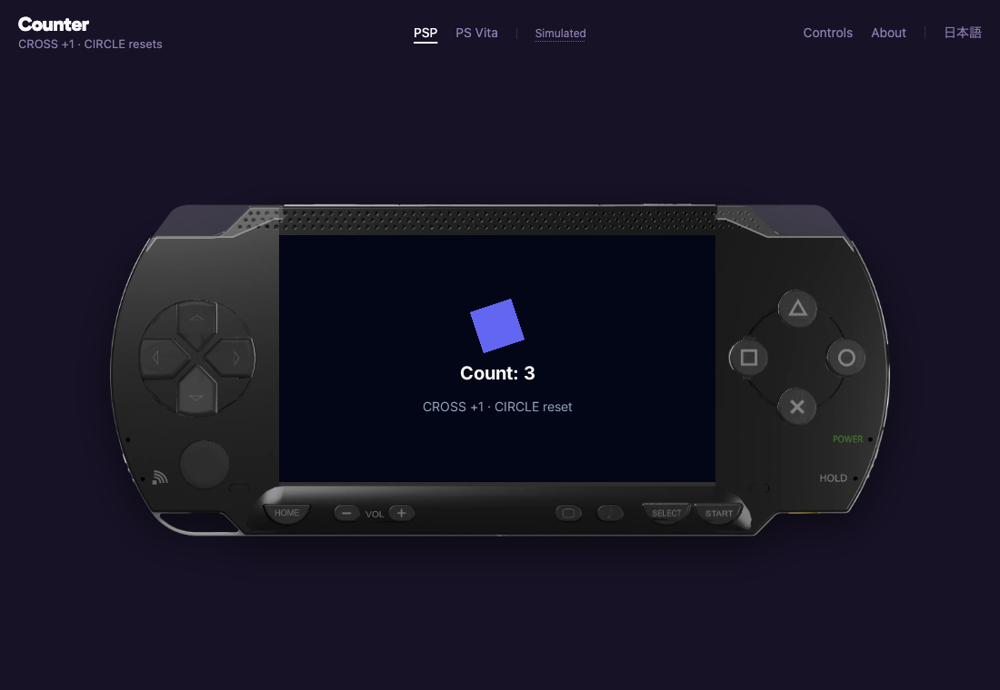

# pocket-player

Play a [PocketJS](https://github.com/pocket-nexus/pocketjs) app on a web page, inside the shell of
the handheld it was built for: PSP, PS Vita or Nintendo 3DS. The shells, their keys, the device
picker and the guest realm are PocketJS's own Pocket3D player, the one behind
[Pocket Duty](https://duty.studio.pocket.nexus/). pocket-player adds one call that boots a
`.pocket` package in it.



```html
<script type="module">
  import { play } from "./pocket-player/0.15/player.js";
  play({ pocket: "app.pocket" });
</script>
```

- The bar offers one device for each variant in the package (`psp`, `vita`, `3ds-dev`), and
  `?device=vita` opens on another. The title is the manifest's.
- Keyboard, pointer and touch drive the shell's keys. A 3DS shows its lower screen.
- `window.pocketPlayer` is the running player, for tools and screenshots: `device`, `frames`,
  `failure`, `present(id)` and `capture()`.

2D apps only for now. A Pocket3D game also needs its own scene renderer, and `play` is where one
will join. When it does, the Pocket3D title card plays, as the Pocket3D License asks.

## Serving it

Serve `dist/<line>/` from **the page's own origin**. The player reads a frame of that directory and
fetches `pocketjs.wasm` from it. Use the line that matches the PocketJS version that built the
package: `dist/0.15/` plays packages built by PocketJS 0.15.

Under a Content Security Policy the page needs these sources:
- `script-src 'self' 'wasm-unsafe-eval' 'unsafe-eval'`
- `connect-src 'self' blob:`
- `frame-src 'self'`
- `img-src 'self'`

Give the directory's own pages the same policy. They run the app's code.

## Building a package

```sh
bunx @pocketjs/cli@0.15.0 create my-app && cd my-app && bun install
bun node_modules/@pocketjs/framework/tools/pocket-pack.ts build \
  --manifest "$PWD/pocket.json" --project-root "$PWD" \
  --target psp --target vita -o "$PWD/dist/my-app.pocket"
```

`example/` is a counter built this way. Serve the repository root and open `/example/`.

## Building dist

```sh
node scripts/build.mjs 0.15
```

The build clones the pinned PocketJS tag and checks its commit. It takes the prebuilt UI core from
the npm package of the same release, checked against its SHA-256. Then it lays the files out as
PocketJS's `tools/pocket3d-web.ts stage` does, bundles the two framework modules the player imports
with esbuild, and writes `files.sha256`. The pins are in `scripts/versions.json`. A new PocketJS
line is a new entry and a new `dist/<line>/`. A published line never changes.

## Licences

pocket-player's own code is MIT. The files `dist/` copies from PocketJS keep their licences, and
each line's `NOTICE.md` lists them:
- **MIT** for the realm, the UI core and the host bundle.
- **The Pocket3D License** for the player, PocketJS's shells and the title card.
- **CC BY 4.0** for the PSP shell. The player's About panel credits it. Keep that credit.
- **SIL OFL** for the Gabarito font.

PSP, PS Vita, PlayStation and Nintendo 3DS are trademarks of their owners. pocket-player is not
affiliated with them or with Pocket Nexus.
